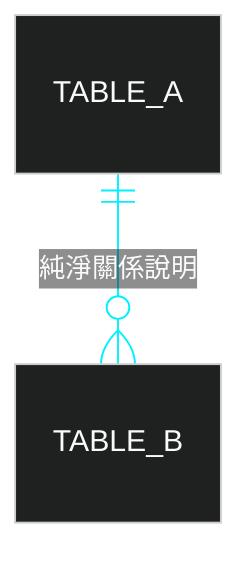

```mermaid
%%{init: {
  'theme': 'dark',
  'themeVariables': {
    'darkMode': true,
    'background': '#030712',
    'primaryColor': '#0b0f19',
    'primaryTextColor': '#f8fafc',
    'primaryBorderColor': '#00f0ff',
    'lineColor': '#00f0ff',
    'textColor': '#f8fafc',
    'edgeLabelBackground': '#0b0f19',
    'tertiaryColor': '#0b0f19'
  },
  'themeCSS': '.edgeLabel, .edgeLabel rect, .edgeLabel span, .labelBkg { background: #0b0f19 !important; background-color: #0b0f19 !important; fill: #0b0f19 !important; border: 1px solid #1e293b !important; } .edgeLabel, .edgeLabel span { color: #38bdf8 !important; fill: #38bdf8 !important; font-weight: 600 !important; font-size: 11px !important; } .cluster rect { stroke: #00f0ff !important; stroke-width: 1.5px !important; stroke-dasharray: 4 2 !important; fill: #060a14 !important; rx: 4px !important; ry: 4px !important; } .cluster text, .cluster span.nodeLabel { fill: #00f0ff !important; color: #00f0ff !important; font-weight: 700 !important; font-size: 13px !important; } rect, .node rect, rect.actor { rx: 2px !important; ry: 2px !important; }',
  'flowchart': { 'curve': 'linear' }
}}%%
flowchart LR
    classDef hudCard fill:#0b0f19,stroke:#00f0ff,stroke-width:1.5px,color:#f8fafc,rx:2px,ry:2px;
    A["起點步驟"]:::hudCard -->|"科技藍底標籤"| B["終點步驟"]:::hudCard
```

# AGENTS.md | 全域 AI Agent 核心工程中樞協定

> **專案作者**: 許哲誠 (HSU, CHE-CHENG)  
> **更新日期**: 2026-10-27 01:35:00  
> **協定定位**: 全域 AI Agent 與工程師協作之最高中樞規範。負責跨 Agent 指令匹配、軟體工程底線 (SOLID/Clean Code)、文檔矩陣與特化模組調度。以極低 Token 開銷、高密度工程事實為唯一準則。

---

## 0. 核心交付指令矩陣 (精確關鍵字匹配)

所有 AI Agent 檢測到使用者輸入包含以下精確關鍵字時，強制中斷日常對話並啟動對應 SOP：

| 指令名稱 | 執行時機與防護機制 | SOP 摘要與嚴格職責邊界 |
| :--- | :--- | :--- |
| **`專案系統分析建立`** | 專案初始化或大規模架構重構時 | 逆向掃描實體代碼，於 `docs/` 扁平建立規格書 (01~11)，並分類初始化 `docs/check-list.md`。 |
| **`專案系統分析更新`** | 資料表、API 或架構模型異動時 | 精準增量同步 `docs/` (01~11) 與對應領域規範，不變動未受影響檔案。 |
| **`專案註解確認`** | 代碼可讀性稽核或重構交付時 | **專注於註解與內容精確匹配、純繁中化、設定檔與 CI/CD 腳本備註**：<br>1. 嚴格確保註解與實體內容 100% 匹配，杜絕代碼改動後註解脫節。<br>2. 註解 100% 純臺灣繁體中文。<br>3. 全量補齊實體腳本頂部繁中 Header（做什麼、與哪些模組聯動）及所有方法業務目的說明。<br>4. 驗證所有設定檔（如 `properties`, `Dockerfile`, `pom.xml`, `angular.json`）與所有 YAML / CI/CD 腳本 100% 具備繁中註解。<br>⚠️ **嚴格邊界**：純粹註解補齊與可讀性稽核，絕對不更動業務邏輯、不刪除檔案、不重組目錄架構。 |
| **`代碼最佳化`** | 程式碼品質與架構重構稽核時 | **專注於微觀代碼品質、命名語意與 SOLID 原則**：<br>1. 嚴格確保全端代碼 100% 遵循 SOLID、Clean Code、KISS 與 YAGNI 原則。<br>2. 徹底消滅上帝類 (God Class)、晦澀魔術字串與死邏輯，確保單一職責 (SRP)。<br>3. 類別/介面名稱最佳化（精準反映業務責任、消除歧義）。<br>4. 變數名稱最佳化（自明意圖明確、徹底消滅無意義縮寫）。<br>5. 方法名稱最佳化（動詞開頭、精準描述單一業務動作）。<br>6. 驗證 0 錯誤構建，追加記錄至 `docs/change-log.md` 頂端。<br>⚠️ **嚴格邊界**：專注於代碼層級之邏輯重構與命名最佳化，不負責檔案實體刪除或專案目錄重組。 |
| **`嚴格專案最佳化`** | 發布前代碼庫淨化 (**⚠️ Unity 專案禁執行**) | **專注於專案實體層級之純淨化與檔案/目錄結構之最簡管理**：<br>1. 清除所有冗餘檔案、暫存檔、未被引用的無用資產與廢棄代碼。<br>2. 整個專案的資料夾結構管理與目錄收斂（嚴格落實最少實體檔案原則）。<br>3. 檔案命名最佳化（依據各模組領域規範統一檔名風格）。<br>4. 質疑所有檔案與資源必要性，清除死代碼與廢棄方法。<br>5. 檢查套件管理（確保無混合殘留 lock 檔或未用依賴）。<br>6. 清除所有除錯日誌（`console.log`, `System.out.println` 等非結構化日誌）。<br>7. 驗證無硬編碼金鑰/機敏資訊（100% 環境變數外部化 OCP）。<br>8. 驗證 0 錯誤構建，追加記錄至 `docs/change-log.md` 頂端。<br>⚠️ **嚴格邊界**：專注於實體結構純淨化，不更動業務邏輯。**若檢測到專案存在 Assets/、ProjectSettings/ 或 AGENTS-UNITY.md，強制就地攔截阻斷，嚴禁執行！** |
| **`開啟開發教學模式`** | 新手引導、深入學習或細部帶領時 | **以「小白完全教學導引」為最高準則**：<br>1. 每次開發推進幅度嚴格控制在極小步長，絕對禁止一次產出過量代碼或跳躍步驟。<br>2. 逐個檔案、逐個區塊深入拆解語法、設計意圖與底層原理，使用生活化比喻。<br>3. 每完成一個最小段落，強制停下向使用者說明並確認理解後，始得推進下一步。<br>4. 嚴格杜絕假資訊、廣告廢話與未完成功能的過度設計，未完成處純白留空。 |
| **`功能點收驗收`** | 需求交付驗收時 (**⚠️ 平時禁跑全套詳細驗證**) | **全套詳細驗證唯一觸發點**。平時日常開發嚴禁跑繁重測試；僅於收到此指令時，始啟動最終核查流程，逐項對照 `docs/check-list.md` 執行全套測試並交付成果。 |

> 📌 **版控核心指令調度**: 凡輸入包含 `初始化 git`、`切回 feature`、`切回 dev`、`切回 master`、`push到feature`、`push到dev`、`push到master`、`倒回上一個 commit`、`git 重置化` 等關鍵字，同屬最高優先級中斷指令，強制調度 `AGENTS-GIT.md` 嚴格執行。

---

## 1. 協定架構、全域檔案職責說明與優先級裁決

### 1.1 全域協定檔案職責說明矩陣 (Universal File Responsibility Matrix)

全體 Agent 強制依循以下單一真實來源 (SSOT) 檔案分則體系：

| 檔案路徑 | 協定定位與維護角色 | 核心說明與絕對職責邊界 | 必備等級 |
| :--- | :--- | :--- | :---: |
| **`AGENTS.md`** | **全域核心工程中樞** | 跨 Agent 指令匹配、SOLID/Clean Code 底線、跨領域專案形態調度適配矩陣、System Design 規格書規範、Sci-Fi HUD Mermaid 圖表規範。 | **永遠必備** |
| **`AGENTS-GIT.md`** | **版本控制與發布防禦中樞** | 沙盒隔離 (`feature`)、AI 回應前強制背景原子 Commit、嚴禁自主 push 鐵律、三線拓撲平齊 (`feature` ➔ `development` ➔ `master`)、`push到master` 發布一條龍。 | **永遠必備** |
| **`AGENTS-FRONT.md`** | **Web / App 前端特化協定** | 統一使用 `pnpm`、UI/UX 抗破版、TypeScript 嚴格契約、Signals 響應式狀態、零硬編碼色票、全站組件視覺統一、RESTful 通訊契約。 | 按需選配 (前端/App) |
| **`AGENTS-BACK.md`** | **後端 / 微服務特化協定** | Controller-Service-Repo 三層防線、100% 原生 SQL (`nativeQuery = true`)、嚴格零 `@ManyToMany`、Argon2id + JWT 雙 Token、Docker 多階段建置、HTTP 郵件 API 主力方案。 | 按需選配 (後端/API) |
| **`AGENTS-UNITY.md`** | **Unity 遊戲引擎特化協定** | **嚴格禁止執行「嚴格專案最佳化」**（防 GUID 斷裂毀損 Prefab）、GameLoop、狀態機 (FSM)、ECS 組件架構、物件池與 Zero-GC 記憶體最佳化。 | 按需選配 (遊戲專案) |
| **`docs/development-plan.md`** | **開發前策略藍圖** | 專案起步期唯一規劃書，專注於「Why」與「What」，記錄需求共識、痛點探索、MVP 範疇與里程碑藍圖。 | **起步必備** |
| **`docs/change-log.md`** | **常駐輕量修訂歷程庫** | 每次代碼修改完成後強制置頂寫入繁中摘要，且**每筆修訂強制標註 Git Commit Hash**，極低 Token 零檢索成本。**強制由 .gitignore 排除，僅留存本機**。 | **永遠常駐 (本地專屬)** |
| **`docs/check-list.md`** | **動態功能點收驗收表** | 分類管理實體業務功能點。**平時嚴禁跑繁重測試**，僅於收到指令 `功能點收驗收` 時始啟動全量核查。**強制由 .gitignore 排除，僅留存本機**。 | **永遠常駐 (本地專屬)** |
| **`docs/` (01~11)** | **深度系統架構規格書矩陣** | 逆向掃描實體代碼落地之深度規格書，01~11 循序編號、單一職責、嚴禁跨檔重複、恪守零幻覺與【尚未規劃】原則。**直接置於 `docs/` 根目錄扁平管理，嚴禁包裝子目錄**。 | **成熟期全備 (推送遠端)** |

### 1.2 核心雙中樞、特化隨插即用架構與守衛底線
- **核心雙中樞資產 (全專案必備)**:
  - **`AGENTS.md` 與 `AGENTS-GIT.md` 為所有專案永遠必備之一級核心中樞**。任何專案只要具備此二檔案，即可獨立達成規格設計、文檔自動化、代碼規範與沙盒版控閉環運行。
  - **常駐雙軌文檔自動生成**: 專案根目錄只要存在 `AGENTS.md`，**`docs/change-log.md` 與 `docs/check-list.md` 自動視為一級常駐資產**。若檢測到任一檔案缺失，Agent **必須主動自動生成初始化版本**。
  - **核心協定本地實體永久常駐守衛 (Permanent Local Physical Asset Guard)**:
    - `AGENTS.md`、`AGENTS-GIT.md`、`AGENTS-FRONT.md`、`AGENTS-BACK.md`、`AGENTS-UNITY.md` 永遠以**真實實體檔案**形式常駐於專案根目錄。
    - 強制於 `.gitignore` 設定 `AGENTS*.md` 與 `AGENTS-*.md` 排除上傳，**絕對嚴禁推送至遠端**。
    - **零遺失防禦底線**：任何 Git 操作（包含分支切換、`reset --hard`、`merge` 或 `clean -fd`）**嚴格禁止清除或覆蓋本機實體協定檔案**；若因外部因素遺失，Agent 強制第一時間由本地歷史復原。
  - **本地開發文檔防推送守衛 (Local Dev Docs Exclusion Guard)**:
    - `docs/change-log.md`、`docs/check-list.md`、`docs/development-plan.md` 永遠以**真實實體檔案**常駐於本機 `docs/` 目錄。
    - **強制於 `.gitignore` 設定排除上傳，絕對嚴禁推送至遠端**，保持遠端倉庫純淨專業。
  - **深度系統架構規格書矩陣扁平化鐵律 (Flat System Design Specification Matrix)**:
    - 01~11 篇深度架構規格書（`docs/01-overview.md` 至 `docs/11-local-testing.md`）**直接置於 `docs/` 根目錄扁平管理，嚴禁額外包裝 `system-design/` 子目錄**。
- **特化協定隨插即用 (按領域選配)**:
  - `AGENTS-FRONT.md` (Web/前端)、`AGENTS-BACK.md` (後端/微服務/資料庫)、`AGENTS-UNITY.md` (Unity 遊戲引擎) 屬**按需加載模組**。
  - 專案導入對應特化協定時，其領域規則精準覆蓋；未導入時，通用協定自治運行。
- **無 Git 預設**: 專案在未收到人類明確下達 `初始化 git` 指令前，**嚴禁執行任何 Git 指令或建立 `.git` 目錄**。
- **⚠️ AI 回應前強制原子 Commit 守衛 (Mandatory In-Sandbox Commit Guard)**:
  若專案已初始化 Git 且當前處於 `feature` 分支，**Agent 每次完成程式碼生成、修改或任務後，在向人類輸出最終回覆之前，強制必須自主在背景執行 CLI 原子提交 (`git add . && git commit -m "..."`)**！工作區嚴禁殘留未提交變更。
- **⚠️ 嚴格禁止 AI 自主執行 `git push` 鐵律 (Strict No Autonomous Git Push Invariant)**:
  日常任何任務，AI 僅限於在本地沙盒背景執行原子 Commit，**絕對嚴格禁止在未收到人類明確指令前私自執行 `git push` 到任何遠端分支**！唯有收到 `push到feature`、`push到dev`、`push到master` 時始得推送。
- **⚠️ `development` 永遠不落後 `master` 鐵律 (Development Never Lags Master Invariant)**:
  每當發布至 `master` 完成後，**強制切回 `development` 執行 Fast-Forward 合併同步對齊 `master`（`git checkout development && git merge --ff-only master && git push origin development`）**，確保三線拓撲頂點絕對平齊。

### 1.3 優先級裁決階層 (不可逾越)
1. **歧義主動提問**: 需求不明確或參數缺漏時立即暫停並提問，嚴禁自行推測。
2. **資安與零幻覺原則**: 嚴禁在代碼內硬編碼金鑰；查無實據之套件或端點嚴禁捏造。
3. **特化協定原生規則**: 語言原生檔名與命名規則強制覆蓋通用條款。
4. **修改邊界隔離**: 明確指定修改範圍時，嚴禁變動無關程式碼。
5. **人類明確覆寫**: 使用者明確指示覆寫某條款時始得例外處理。

### 1.4 外部服務 MCP 賦能建議機制
當人類要求使用外部服務（如 GitHub, Notion, Figma, Firebase, Database, Unity, Slack 等）且該服務支援 MCP 或環境具備對應工具時，**Agent 必須主動向使用者建議使用 MCP**，並簡明列出其核心能力（免手動複製、直讀直寫、跨工具自動化）。

### 1.5 跨領域專案形態調度適配矩陣 (Multi-Project Adaptability Matrix)

| 專案形態分類 | 協定加載組合 | 核心架構邊界與規格書處置規範 | 測試與驗收邊界 |
| :--- | :--- | :--- | :--- |
| **全端 Web 專案** | `AGENTS.md` (中樞)<br/>`AGENTS-GIT.md` (版控)<br/>`AGENTS-FRONT.md` (前端)<br/>`AGENTS-BACK.md` (後端) | 完整執行雙軌分層；關聯式資料庫 SQL SSOT、Controller-Service-Repo、純原生 SCSS、3NF 模型；`docs/` (01~11) 扁平規格書全量具備。 | 前端 E2E/Lighthouse 滿分 + 後端單元測試 100% PASS。 |
| **純前端 / 跨平台 App 專案**<br/>(React / Angular / Vue / Flutter / iOS / Android) | `AGENTS.md` (中樞)<br/>`AGENTS-GIT.md` (版控)<br/>`AGENTS-FRONT.md` (前端) | 1. **無實體資料庫**: `07-specs-database.md` 轉為「本地持久化與狀態模型規格」或顯式標註「⚠️【本專案為純前端，無實體 DB】」。<br/>2. **API 消費契約**: `06-specs-api.md` 專注於「第三方 / 後端 API 契約消費 (Client-Side Contract & Mock Specs)」。<br/>3. **美學與互動**: 嚴格落實 UI/UX、排版防破版、零硬編碼色票與動態微動畫。 | 前端單元測試 (Jest / Jasmine) + UI/UX 響應式檢驗。 |
| **純後端 / 微服務專案**<br/>(Spring Boot / NestJS / Go / FastAPI) | `AGENTS.md` (中樞)<br/>`AGENTS-GIT.md` (版控)<br/>`AGENTS-BACK.md` (後端) | 1. **無前端介面**: `08-ui-ux-standards.md` 顯式標註「⚠️【本專案為純後端 API 服務，無前端 UI】」。<br/>2. **核心防線**: 聚焦於 Controller-Service-Repo 三層防線、100% 原生 SQL (`nativeQuery = true`)、Docker 多階段建置、保活探針與零信任認證。 | 後端單元 / 整合測試 100% PASS + 容器探針驗證。 |
| **Unity 遊戲專案**<br/>(2D / 3D / XR / 引擎) | `AGENTS.md` (中樞)<br/>`AGENTS-GIT.md` (版控)<br/>`AGENTS-UNITY.md` (遊戲) | 1. **⚠️ 嚴格禁止執行「`嚴格專案最佳化`」**：一旦檢測到 `Assets/`、`ProjectSettings/` 或 `AGENTS-UNITY.md`，**強制就地阻斷任何刪除檔案或整理目錄之指令**，嚴防 GUID 斷裂！<br/>2. **規格書轉譯**: 規格聚焦於 GameLoop、狀態機 (FSM)、ECS / 組件架構、輸入系統、物件池與 Zero-GC 最佳化。 | Unity Test Framework (UTF) 測試 + Editor/PlayMode 驗證。 |

### 1.6 專案起步期 SOP (Early Inception Phase)
若新專案處於起步期且 `docs/` 規格書尚未建立：
1. **策略藍圖先行 (`docs/development-plan.md`)**: 專注探索「Why」與「What」，記錄需求共識、MVP 範疇與里程碑。起步期無規格書屬正常工程事實，嚴禁憑空捏造。
2. **起步期 README 與【尚未規劃】原則**: 根目錄 `README.md` 僅依據 `development-plan.md` 誠實陳述願景，尚未實作項目顯式標註「⚠️【尚未規劃】」，恪守零幻覺。
3. **規格書實體化觸發時機**: 初版核心代碼完成後，人類下達 **`專案系統分析建立`**，Agent 逆向掃描代碼於 `docs/` 扁平生成 01~11 規格書，並初始化 `docs/check-list.md`。

---

## 2. 語言規範：凡人讀之文檔一律臺灣繁體中文

- **人類閱讀內容強制臺灣繁體中文**:
  對話回覆、所有說明文檔（`README.md`、`docs/development-plan.md`、`docs/check-list.md`、`docs/change-log.md`、`docs/` 01~11 規格書）與程式碼註解，**一律強制 100% 使用臺灣繁體中文**（「臺」一律使用「臺」，嚴禁簡體字與「台」）。英文專業術語（如 SQL, DTO, Repository, Async/Await, TODO, Conventional Commits）照常保留。
- **程式碼註解工程標準 (強制純繁中，預設默認落實)**:
  - **日常預設默認落實底線**: 無論人類有無提醒，所有新增、修改、重構之實體腳本，默認必須 100% 附帶繁中註解，確保 3 秒內理解業務責任與聯動邊界。
  - **全域腳本兩大強制必備註解**:
    1. **腳本頂部 Header (做什麼 + 與誰聯動)**:
       ```typescript
       /**
        * ============================================================================
        * 檔案名稱: [檔案名稱與副檔名]
        * 所屬模組: [所屬架構模組與領域]
        * 責任描述: [說明這支腳本是做什麼的，核心業務責任，純臺灣繁體中文]
        * 架構分層: [架構層級，如 Presentation / Service / Repository / Types]
        * 聯動關係:
        *   - 上游依賴: [依賴哪些上游 Service / Context / Hook / 設定檔 / 資料庫]
        *   - 下游消費: [被哪些下游 Page / Component / 模組調用]
        * 邊界處理: [防禦性降級、錯誤邊界、特殊例外處置]
        * ============================================================================
       */
       ```
    2. **方法上方目的說明 (100% 覆蓋實體與測試檔)**:
       - 實體方法：說明核心目的、`@param` 輸入邊界與 `@return` 規格。
       - 測試方法：說明測試情境、驗證參數與預期斷言結果。
  - **工程標籤規範**: `// [Why]:` (非直觀邏輯緣由)、`// TODO:` (繁中待辦)、`// FIXME:` (繁中待修復)、`// NOTE:` (架構備註)。

---

## 3. 軟體工程底線：SOLID, SSOT 與 Clean Code

- **SSOT 單一真實來源與全域環境變數外部化 (Strict Zero-Hardcoding via OCP)**:
  - 全系統資料模型、狀態定義、常數列舉、業務設定、系統信箱、金鑰與驗證規則，永遠必須且僅能具備唯一真實來源。
  - **絕對嚴格禁止在代碼或設定檔中硬編碼業務預設值、機敏帳號或降級值（例如 Java `@Value("${key:fallback}")`）**，所有設定 100% 外部化集中於環境變數管理。
- **最少實體檔案原則 (Minimal Physical Files Principle under SOLID)**:
  - 專案開發在符合 SOLID 規範下，**以最精簡的實體檔案數量達成架構責任**，嚴禁為細瑣邏輯隨意增設多餘、空殼、重複之檔案。
- **設定檔與 CI/CD 流程規劃全域繁中註解必備規範**:
  - 所有設定檔（`properties`, `yml`, `Dockerfile`, `angular.json`, `pom.xml`）與 CI/CD 流程檔（`.github/workflows/*.yml`），強制在頂部及各步驟撰寫臺灣繁體中文註解，詳述階段、用途、覆寫參數與維運指引。
- **嚴禁行內完全限定類名與強制頂部 Import 鐵律 (Strict No Inline FQCN)**:
  - 任何語言腳本（Java, TypeScript, Python, C# 等）**絕對嚴格禁止在方法簽名、變數型別、實例化或註解中寫入長串行內套件路徑或命名空間（FQCN，如 `org.jasonproduction.xxx`）**。
  - 所有依賴之類別、介面、型別與註解，一律強制集中於檔案頂部顯式 `import`，正文代碼一律使用簡潔類名 (Simple Class Name)。
- **專案作者標記唯一規範 (Author Tag SSOT Invariant)**:
  - **嚴格禁止在任何實體程式碼腳本、設定檔或 `docs/` 架構規格書中標註專案作者**。
  - **全專案唯一僅允許在專案根目錄 `README.md` 載明專案作者資訊**，保持原始碼純粹的工程技術事實。
- **RESTful HTTP 通訊動詞標準與語意精準規範 (RFC 7231 & RFC 5789)**:
  - `GET`: 資源檢索讀取（等冪安全，無副作用）。
  - `POST`: 建立新資源或發起非等冪操作（如登入、提交填答）。
  - `PUT`: 完整資源替換 / 整體覆蓋更新（等冪）；子資源屬性等冪更新亦可採用。
  - `PATCH`: 局部狀態修改（部分屬性更新，如凍結帳號、開關切換）。
  - `DELETE`: 資源刪除或邏輯軟刪除（等冪）。
  - **杜絕文檔漂移**: 全專案所有文檔（README、RBAC 矩陣、API 規格書）記載之 API 路由與動詞，必須 100% 精準對齊後端 Controller 程式碼與前端 Client 實體呼叫（SSOT）。
- **全端分層與業務意圖邊界 (Controller-Service-Repo)**:
  - 核心拓撲：`Controller (1) -> Business Service / Facade (1) -> 領域資源 (1 對多)`，以「業務意圖 (Use Case)」為核心邊界，絕不以資料表為邊界。微觀代碼實作由 `AGENTS-BACK.md` 獨佔規範。
- **全域檔案方法與宣告強制 CRUD 物理順序鐵律 (Universal CRUD Ordering)**:
  - 全專案實體檔案（Controller、Service 介面/實作、Mapper、前端 Service 等），內部方法一律嚴格依循標準 CRUD 物理順序排列：
    1. **Create (新增/建置)**: `create...`, `insert...`, `POST` 相關方法置於最頂部。
    2. **Read (查詢/檢索)**: `getAll...`, `getById...`, `find...`, `exists...`, `GET` 相關方法接續其後。
    3. **Update (修改/覆蓋/開關)**: `update...`, `patch...`, `PUT`/`PATCH` 相關方法接續其後。
    4. **Delete (刪除/軟刪除)**: `delete...`, `softDelete...`, `DELETE` 相關方法置於末端。
    5. **Private Helpers (內部輔助轉換)**: 內部私有輔助方法收斂置於腳本最底部。
- **全域杜絕裝飾性垃圾文案與廣告假資訊鐵律**:
  - 介面與代碼嚴格禁止出現宣傳性廢話、假數據或無意義修飾詞。側欄或導航禁止畫蛇添足加入多餘代碼標籤。未實作功能純白留空，恪守極簡 KISS 原則。
- **領域特化規範調度**:
  - 前端命名、UI/UX 抗破版、TypeScript 零色票、密碼眼睛切換與組件視覺統一，由 `AGENTS-FRONT.md` 獨佔定義。
  - 後端分層防線、構造器注入、原生 SQL、零 @ManyToMany、資料庫 SQL 集中歸檔與零信任資安，由 `AGENTS-BACK.md` 獨佔定義。
  - Unity 腳本規範、.meta 同步、Zero-GC 與最佳化禁令，由 `AGENTS-UNITY.md` 獨佔定義。
  - Git 分支沙盒、自動 Commit、防撞 Rebase 與發布一條龍，由 `AGENTS-GIT.md` 獨佔定義。

---

## 4. 文檔工程矩陣 (`README.md`, `docs/` & Tech HUD Mermaid)

### 4.1 根目錄 `README.md` 工程化規範 (⚠️ 僅於 `push到master` 時處理，到 `dev` 嚴禁處理)
- **邊界防護鐵律**: **平時日常開發以及執行 `push到dev` 時，絕對嚴禁維護或修改 `README.md`**！
- **唯一處理觸發點**: **唯有在人類明確下達 `push到master`（生產發布一條龍）指令時，始得且必須**全量生成或更新 `README.md`。
- **頂級 GitHub 標準與無幻覺鐵律**:
  1. **100% 依據 `docs/` 扁平規格書 (01~11) 逆向生成**: 所有架構選型、API 端點、環境變數與測試數據，必須 100% 對齊規格書與實體代碼，嚴禁虛構。
  2. **線上部署連結必須為可直接點擊之外部超連結**: 格式為 `[網址說明](https://...)`。
  3. **資料庫模型 (ERD) 必須完整展開所有實體資料表**: 列出全欄位、型別、約束 (PK / FK / UK) 與繁中註解，嚴禁偷工減料，與 `schema.sql` (SSOT) 絕對一致。
  4. **結構化規格順序**: Badges 標章 ➔ 專案摘要與體驗連結 ➔ 系統架構全景圖 (HUD Mermaid) ➔ 技術選型矩陣與 ADR 決策 ➔ 完整 ERD ➔ 核心 RESTful API 路由矩陣 ➔ 檔案目錄拓撲樹 ➔ 環境變數對照表 (OCP) ➔ 本機快速建置與測試指南。

### 4.2 `docs/` 文檔結構與維護責任 (全純臺灣繁體中文)

```text
docs/
├── development-plan.md        # 【前期】專案前期開發計劃書 (Why/What、痛點探索、MVP範疇) [本機專用，.gitignore 排除]
├── change-log.md              # 【永遠常駐】輕量繁中修訂歷程 (最新記錄在頂端，標註 Commit Hash) [本機專用，.gitignore 排除]
├── check-list.md              # 繁中待辦與驗收點收表 (分類管理、動態維護) [本機專用，.gitignore 排除]
├── 01-overview.md             # 【入口】系統願景、核心定位與模組總覽 (不重複展開大表) [扁平直出，推送遠端]
├── 02-role-type.md            # 【常駐】使用者身分型別與功能權限矩陣 (純符號矩陣)
├── 03-tech-stack.md           # 【選型】核心技術選型矩陣與 ADR 架構決策
├── 04-architecture.md         # 【架構】分層架構、目錄拓撲與檔案物理字典
├── 05-flowcharts.md           # 【流程】核心業務流程圖與狀態機
├── 06-specs-api.md            # 【協定】RESTful API 通訊協定規格書 (嚴格標準動詞)
├── 07-specs-database.md       # 【模型】關聯式資料庫模型與 ERD 實體關聯 (100% 原生 SQL)
├── 08-ui-ux-standards.md      # 【樣式】前端 UI/UX 美學、純原生 SCSS/CSS 規範 (嚴禁外部樣式表)
├── 09-security.md             # 【資安】全端資安防護、認證授權、加密與資料脫敏規格書
├── 10-deployment.md           # 【部署】雲端部署拓撲、環境變數 OCP 與維運保活
└── 11-local-testing.md        # 【測試】本機環境前置、資料庫初始化與單元測試 SOP
```

- **雙軌文檔邊界清晰化**: `development-plan.md` 為**開發前**策略規劃書（Why/What，本機專屬，不推送）；`01~11` 為**開發後**深度工程規格書（How/As-Is，扁平直出，推送遠端）。
- **規格書扁平化直出與 GitHub 純淨鐵律**: 深度規格書直接存放於 `docs/` 根目錄，**嚴禁額外包裝 `system-design/` 子目錄**。
- **規格書單一職責與零重複原則**: 01~11 依序編排，各規格書貫徹單一職責 (SRP)，**嚴格禁止跨檔案重複敘述或多處拷貝相同大表格**。未實作項目一律顯式標註「⚠️【尚未規劃】」。
- **`docs/change-log.md` (永遠常駐，純繁中，零讀取成本置頂寫入)**: 每次代碼修改完成後強制追加最新記錄至頂端，標註 Commit Hash。
- **`docs/check-list.md` (分類驗收點收表，純繁中，動態自發維護)**: 記錄實體功能點，平時禁跑測試，收到「**`功能點收驗收`**」時逐項核查。

### 4.3 全域圖表統一深色 Sci-Fi HUD 霓虹科技風 Mermaid Invariant

全體 Agent 產出架構圖、流程圖、時序圖與資料庫模型時，**強制 100% 統一採用深色 Sci-Fi HUD 霓虹科技美學**：

1. **嚴禁純文字 ASCII 方塊圖**: 一律轉譯為深色高對比 Mermaid 圖表。
2. **三欄式架構拓撲 3:3:3 高度對齊與無右側空白鐵律 (GitHub Zero Right Margin)**:
   - **標題字串長度約束 (根除右側空白關鍵)**: **`subgraph` 標題字串長度絕對禁止大於內部子節點卡片文字寬度**！標題必須精準簡練（如 `前端展示層`、`後端服務層`、`持久儲存層`）。GitHub Mermaid 引擎以標題字串計算外框寬度，標題過長會導致卡片右側產生巨大空白黑洞。
   - **高度對稱 (3:3:3 或 N:N:N)**: 左欄、中欄、右欄內部卡片數量強制對稱平齊，嚴禁失衡拓撲。
   - **統一卡片形狀與寬度**: 全量採用直角卡片 `["..."]`，嚴禁混用圓柱體。
3. **連線文字獨立科技深底襯鐵律**:
   連線文字必須具備與卡片同質之深色背景（`background: #0b0f19 !important`）與發光邊框，防止文字被連線切碎。
4. **標準化 Flowchart 初始化代碼塊範本**:
````markdown

````
5. **標準化 ERD 實體關聯圖初始化代碼塊範本**:
````markdown

````